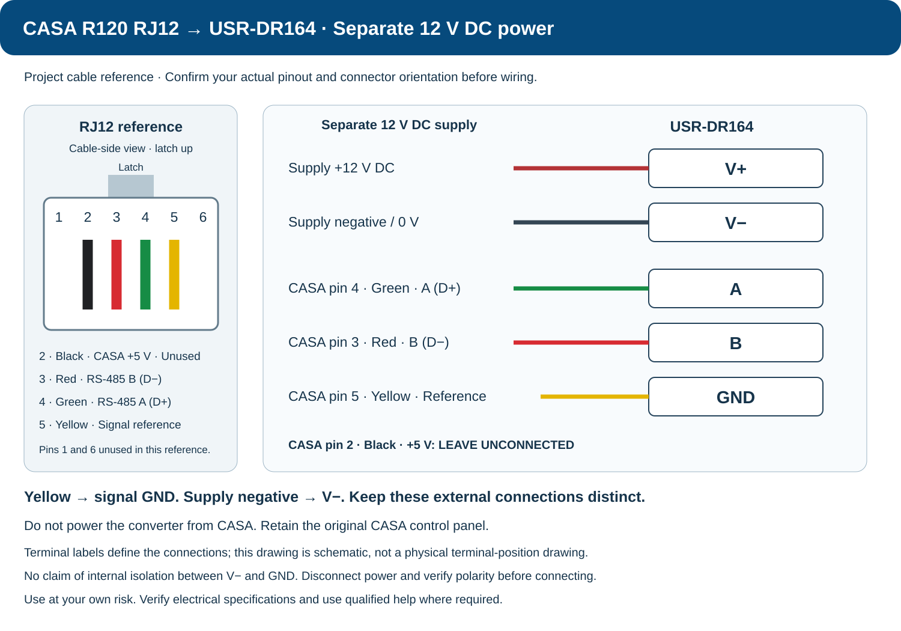
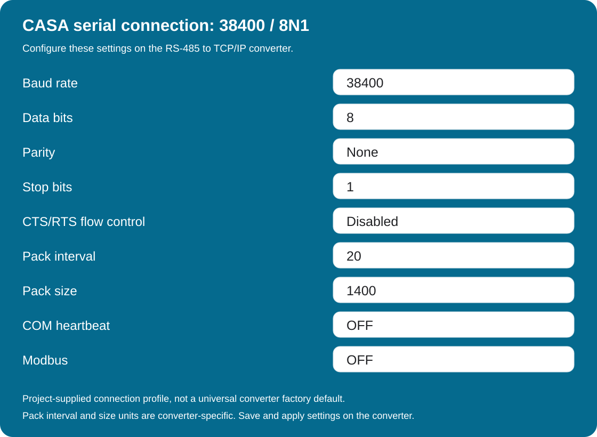

# Wiring and converter settings

[← Back to CASA Premium](../README.md)

## CASA R120 reference connection

The diagram below follows the project R120 cable reference: **view from the cable side, latch up**. Confirm that orientation and the actual cable before connecting. Wire colours and pin assignments shown here must not be assumed for other CASA cables or controllers.

| CASA RJ12 pin | Wire in the reference cable | Signal | Converter terminal |
| --- | --- | --- | --- |
| 2 | Black | +5 V from CASA | **Leave unconnected** |
| 3 | Red | RS-485 B (D−) | **B** |
| 4 | Green | RS-485 A (D+) | **A** |
| 5 | Yellow | Signal reference | **GND** |

Pins 1 and 6 are unused in this reference. Yellow connects to **signal GND**, not the power-input V− terminal shown on some converters. Locate terminals by their labels; the diagram does not prescribe the terminal positions on every converter. Power the USR-DR164 from a **separate 12 V DC supply**: positive to **V+**, negative/return to **V−**. The yellow CASA conductor remains on **signal GND**; do not move it to V−. Do not power the converter from the CASA +5 V conductor. Keep the original CASA panel and safety mechanisms operational.

## Separate 12 V DC power

| Connection | USR-DR164 terminal |
| --- | --- |
| Separate supply +12 V DC | **V+** |
| Separate supply negative/0 V return | **V−** |
| CASA yellow signal reference | **GND**, not V− |

Disconnect power before making connections. Check polarity, supply rating and the markings on your actual converter. **V− is the supply return; GND is the designated serial signal-reference terminal.** This distinction describes the external wiring and does not assert that the terminals are electrically isolated inside the converter.

The [manufacturer's USR-DR164/162 manual](https://www.pusr.com/uploads/20241212/c0e4f462ecead06a7e47e13fee88a488.pdf) specifies a 5–36 V DC input range; the project uses a separate 12 V DC supply within that range. The manufacturer's voltage range is not permission to take power from the CASA connector. The RJ12 mapping above is the project's cable reference, not an independently certified manufacturer pinout.

## Serial profile

Set the converter to **38400 baud / 8N1 / no hardware flow control** for the documented R120 project setup. This is the project's installation profile, not a claim about every converter's factory defaults or every CASA model.

| Setting | Value |
| --- | --- |
| Baud rate | **38400** |
| Data bits | **8** |
| Parity | **None** |
| Stop bits | **1** |
| CTS/RTS hardware flow control | **Disabled** |
| Pack interval | 20 |
| Pack size | 1400 |
| COM heartbeat | OFF |
| Modbus | **OFF** |

Pack interval and size are transcribed from the project converter settings; check their units in your converter's manual. Save and apply settings on the converter, restarting it only if its interface requires it. Home Assistant's setup form does not configure the serial profile.

## TCP and local network

Configure the converter as a **transparent TCP server**, with **Modbus disabled**. Use a stable address/hostname and TCP port **8899**, or choose another port consistently on both the converter and Home Assistant.

Home Assistant must be able to connect to that local TCP port. The converter must provide the existing CASA serial telegram stream; the integration does not send polling or control telegrams to obtain missing values. Each Home Assistant instance supports one active gateway. Read-only monitoring of the same CASA system has been tested with two Home Assistant instances. This does not establish support for multiple active gateways within one Home Assistant instance. If multiple clients share one converter, check its simultaneous TCP client capacity. Simultaneous control commands from multiple clients have not been tested and are outside this read-only release.

The gateway connection does not use application-layer authentication or TLS. Keep it on a trusted local network. **Do not expose the gateway to the internet or configure router port forwarding for it.**

Continue with [Marketplace/HACS installation and GUI setup](installation.md).
