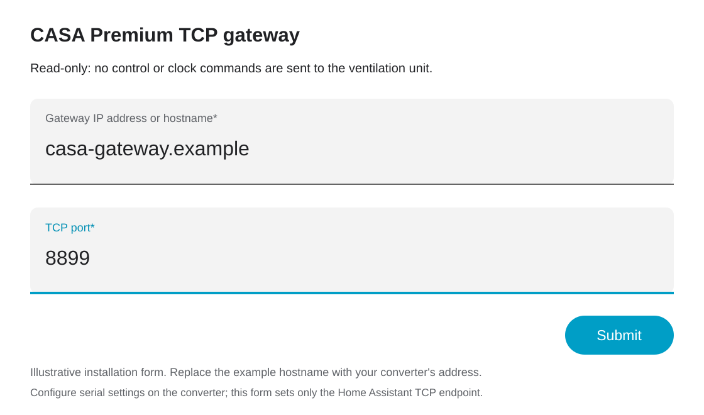

# Installation and configuration

[← Back to CASA Premium](../README.md)

## Before you start

- Check your [unit and controller](supported-devices.md).
- Wire and configure the [RS-485 to TCP/IP converter](hardware.md).
- Use Home Assistant Core 2026.11.2, the tested baseline. On Core 2026.11 and later, use the built-in Marketplace; do not install the legacy HACS integration for this purpose.
- Create a full Home Assistant backup. If replacing a previous integration, keep a copy of its complete integration directory too.

## Install through Marketplace (Core 2026.11 and later)

1. Open **Settings → Marketplace → Add from link**.
2. Enter `https://github.com/astroctrl-dev/ha-casa-premium` and select **Add**. Connect your GitHub account if Marketplace asks. This GitHub connection belongs to the installation tool; CASA monitoring itself needs no cloud account.
3. Select **Integration** if asked, open **Swegon CASA Premium**, select the intended release and install it.
4. Save configuration changes and run Home Assistant's configuration check. On HA OS: `ha core check`. If validation fails, stop and restore your backup.
5. Follow any restart prompt. For this release, restart **Home Assistant Core** fully before setup. On HA OS: `ha core restart`. A YAML reload is insufficient for installed Python files.

The Marketplace may load a new GUI integration immediately after first installation; a full restart remains the conservative procedure documented here. Updates to already loaded Python code require a restart.

## Legacy HACS menus

On an older installation that still uses HACS, open **HACS → menu → Custom repositories**, enter the same URL, select **Integration**, and download the intended release. Earlier Core versions have not been tested; the current release metadata sets Core 2026.11.2 as the installation floor. Do not interpret these legacy menu directions as verified support for earlier Core versions.

For a prerelease, enable prerelease/beta visibility in the installation tool and select that release explicitly. This project is added from a custom repository link; it is not listed in the default catalogue. A private staging repository cannot yet be installed through this public distribution path.

## Add the connection

1. Open **Settings → Devices & services → Add integration**.
2. Search for **Swegon CASA Premium**.
3. Enter the converter's reachable IP address or hostname.
4. Enter its TCP listening port: **8899** by default.
5. Select **Submit**.

The hostname in this illustration is an example, not a device on your network. Enter the converter's address, not Home Assistant's address. Once matching serial traffic arrives, sensor entities will have values. A successful TCP connection alone does not confirm correct serial wiring or protocol data.

## Change the IP address or port

Open **Settings → Devices & services → Swegon CASA Premium → Configure/Options**. Change the desired fields and save. Invalid values or failed connection probes are rejected; the previous saved settings remain in place. A valid change reloads the connection.

Do not delete and recreate the integration just to change the endpoint. Do not configure the same gateway simultaneously through YAML and the GUI. Existing YAML support remains for compatibility; the GUI is the recommended setup path.

## What is configured where?

| Setting | Configure it in |
| --- | --- |
| Converter network address and TCP server/listening port | Converter's configuration interface |
| Serial baud rate, parity, data/stop bits and flow control | Converter's configuration interface |
| Address/hostname and TCP port used by Home Assistant | Integration's setup or Configure/Options form |

Changing a field in Home Assistant does not reconfigure the converter. See [hardware settings](hardware.md) for the 38400/8N1 project profile and local-network prerequisites.

For updates, restore and removal, see [maintenance](troubleshooting.md#update).
